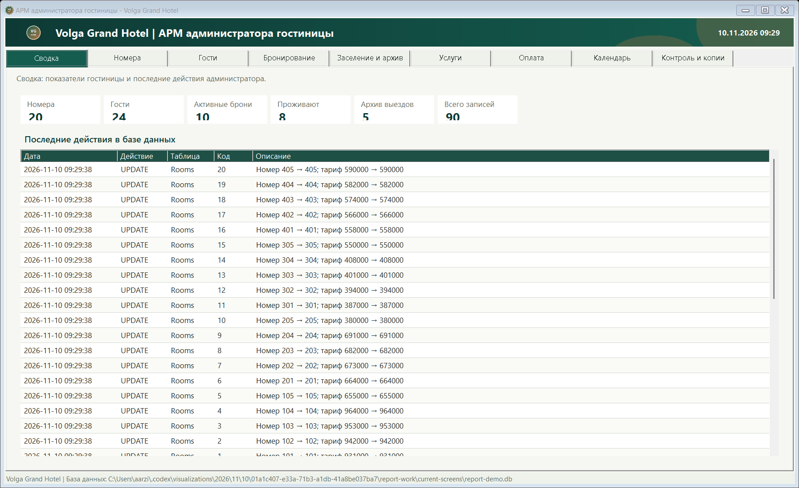
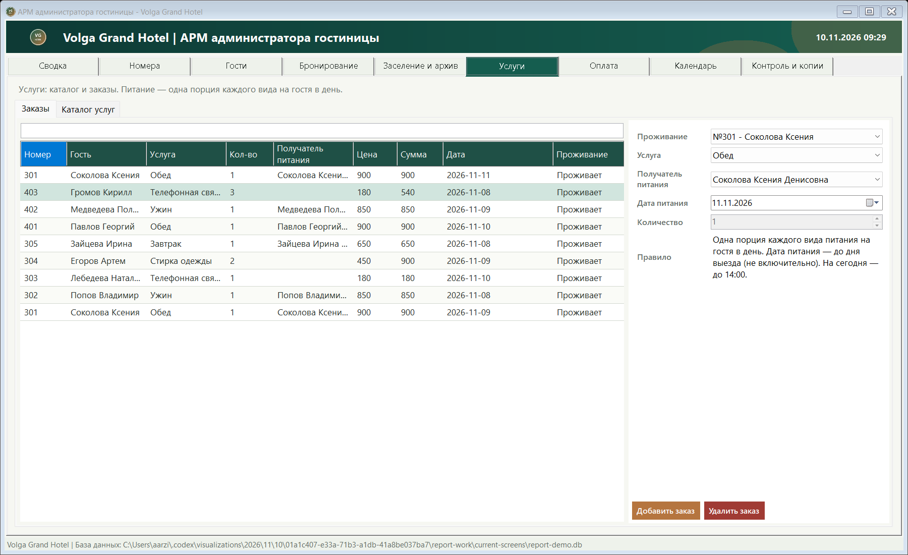

# АРМ администратора гостиницы

Курсовая работа по дисциплине «Системы управления базами данных»: настольное приложение **Volga Grand Hotel**.

**Автор:** Терехов С. М., группа **ПИНз-122**. C#, Windows Forms, .NET 8, SQLite.

## Возможности

- Номерной фонд: категории, вместимость, цена за весь номер в сутки, фото, ремонт и активность.
- Гости: карточки, нормализация паспорта, контакты и состав проживающих.
- Бронирование: поиск по датам, категории и вместимости; подтверждение и отмена; проверка пересечений.
- Проживание: заезд по брони или без неё, продление, переселение с историей тарифов, архив.
- Услуги: редактируемый каталог, исторические цены, правила повторения и получатель питания.
- Оплата: единый расчёт нескольких проживаний, выбор плательщика и способа, детализация, печать.
- Календарь, контроль проблем, журнал, резервное копирование и восстановление.

## Дата и время питания

В «Услуги → Заказы» выберите проживание, вид питания, получателя и **«Дата питания»**.
Разрешены дни от сегодня до дня перед плановым выездом. День выезда не включается.
На сегодня заказы принимаются строго **до 10:00 для завтрака**, **до 14:00 для обеда** и **до 20:00 для ужина** по местному времени компьютера.
В момент наступления границы сегодняшний заказ уже отклоняется. Будущий день доступен в пределах проживания.
Одна порция каждого вида на гостя в выбранный день; повторный каталог или другое проживание того же гостя не обходят лимит.
Обычные услуги сохраняются текущей датой. Дата питания отображается в заказах и счёте.

## Готовая сборка

Запустите `Published/HotelAdminArm.exe` на Windows с **.NET Desktop Runtime 8**. Сохраняйте весь каталог `Published` рядом с EXE.

Рабочая база: `%LOCALAPPDATA%\HotelAdminArm\hotel.db`. Пользовательская база в репозиторий не включена.
Для отдельного демо без изменения рабочей базы:

```powershell
.\Published\HotelAdminArm.exe --database "$env:TEMP\hotel-demo.db"
```

## База версии 6

15 пользовательских таблиц, 116 столбцов, 19 внешних ключей и 66 триггеров.
Деньги рассчитываются в целых копейках, согласованные тарифы и закрытые счета сохраняются.
Перед миграцией существующей базы автоматически создаётся SQLite-копия в `Backups`.
Версия 6 обновляет правила питания, сохраняя старые заказы, историю и зарегистрированные суммы.
Периоды размещения считаются как `[заезд, выезд)`; просроченное активное проживание блокирует номер до фактического выезда.

## Сборка и проверки

Нужен .NET SDK с поддержкой `net8.0-windows`. Из корня репозитория:

```powershell
dotnet build Source/HotelAdminArm.sln -c Release
dotnet run --project Source/HotelAdminArm.Tests -c Release
dotnet publish Source/HotelAdminArm/HotelAdminArm.csproj -c Release -o Published
```

Тесты используют отдельные временные базы. Целевой запуск проверки питания:

```powershell
dotnet run --project Source/HotelAdminArm.Tests -c Release -- --meal-dates
```

Последний подтверждённый полный запуск: **87 успешно, 1 ошибка из 88**. Все **9** новых сценариев питания пройдены.
Неуспешный сценарий проверяет ориентацию интерфейса при 1366×768 и DPI 120 (125 %): его ожидание расходится с компоновкой по эффективной ширине.
Это известный результат; полное успешное прохождение набора не заявляется.

## Документация

- [Пояснительная записка Word](Source/HotelAdminArm/Docs/Пояснительная_записка_АРМ_гостиницы_Терехов_СМ.docx)
- [Пояснительная записка PDF](Source/HotelAdminArm/Docs/Пояснительная_записка_АРМ_гостиницы_Терехов_СМ.pdf)
- [История изменений](CHANGELOG.md)
- [Модель данных](Source/HotelAdminArm/Docs/Модель_данных.md)
- [Инструкция по запуску](Инструкция_по_запуску.md)

Полные исходные тексты размещены в [этом репозитории](https://github.com/ignil722/hotel-admin-arm.git).

## Структура

| Каталог | Назначение |
|---|---|
| `Source/HotelAdminArm/Domain` | Бизнес-операции и расчёты |
| `Source/HotelAdminArm/Data` | SQLite, схема, миграции, правила и демо |
| `Source/HotelAdminArm/MainForm*.cs` | Формы, поиск, календарь и печать |
| `Source/HotelAdminArm.Tests` | Регрессионные сценарии |
| `Source/HotelAdminArm/Docs` | Записка, модели, инструкции, снимки |
| `Published` | Готовая Release-сборка |




Авансы, частичные оплаты, возвраты, авторизация, эквайринг и фискализация не реализованы.
Выбор банковской карты или перевода только регистрирует способ расчёта.
