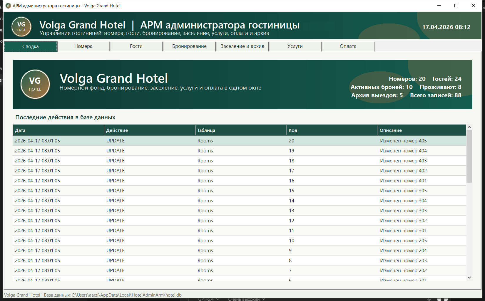
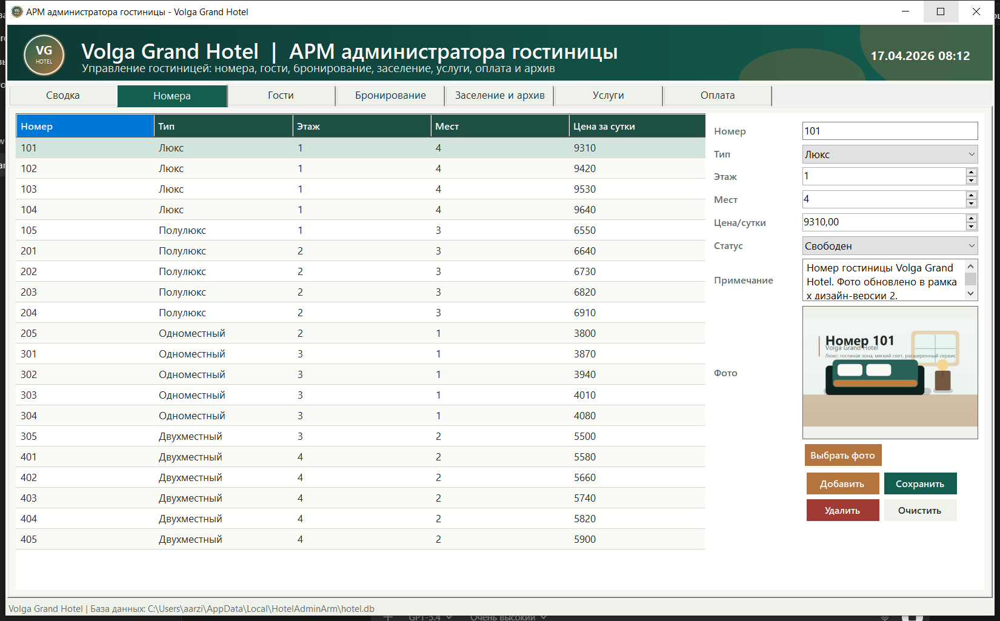
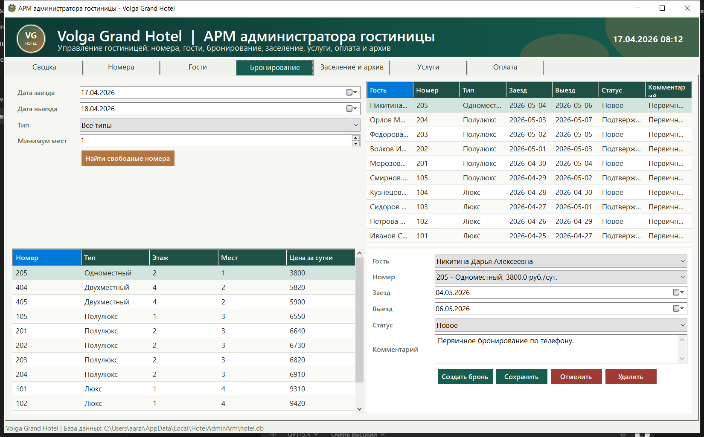
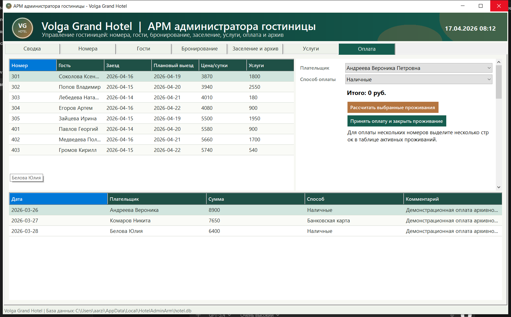

# АРМ администратора гостиницы

Курсовая работа: настольное приложение для управления гостиницей **Volga Grand Hotel**.

**Автор:** Терехов С. М., группа ПИНз-123.

## Возможности

- Управление номерами, их категориями, стоимостью и изображениями.
- Ведение карточек гостей.
- Поиск свободных номеров на выбранные даты и оформление бронирований.
- Заселение по брони или без неё, оформление выезда и хранение архива проживаний.
- Управление дополнительными услугами.
- Регистрация оплаты одного или нескольких номеров одним клиентом.
- Журнал действий и демонстрационные данные при первом запуске.

## Технологии

- C# и Windows Forms.
- .NET 8, целевая платформа `net8.0-windows`.
- SQLite и `Microsoft.Data.Sqlite`.

## Запуск из исходного кода

Потребуются Windows 10/11 и .NET SDK 8. Для работы в Visual Studio установите компонент **Разработка классических приложений .NET**.

1. Скачайте репозиторий или клонируйте его:

   ```powershell
   git clone https://github.com/ignil722/hotel-admin-arm.git
   cd hotel-admin-arm
   ```

2. Откройте `Source/HotelAdminArm.sln` в Visual Studio, дождитесь восстановления NuGet-пакетов и нажмите **F5**.

Также приложение можно собрать и запустить через терминал из корня репозитория:

```powershell
dotnet build Source/HotelAdminArm.sln --configuration Release
dotnet run --project Source/HotelAdminArm/HotelAdminArm.csproj
```

## Готовая сборка

В папке `Published` находится готовая сборка приложения. Для запуска на Windows откройте `Published/HotelAdminArm.exe`. Потребуется установленный **.NET Desktop Runtime 8**; сохраняйте остальные файлы папки рядом с исполняемым файлом.

## База данных

При первом запуске приложение автоматически создаёт базу SQLite и заполняет её демонстрационными данными. База хранится отдельно от исходного кода:

```text
%LOCALAPPDATA%\HotelAdminArm\hotel.db
```

## Структура репозитория

| Путь | Содержимое |
|---|---|
| `Source/HotelAdminArm.sln` | Решение Visual Studio |
| `Source/HotelAdminArm` | Исходный код приложения |
| `Source/HotelAdminArm/Data` | Схема базы, работа с SQLite и демонстрационные данные |
| `Source/HotelAdminArm/Docs` | Пояснительная записка, лабораторные работы, диаграммы и снимки экрана |
| `Published` | Готовая сборка приложения |

В корне также находятся задание на курсовую работу и подробная инструкция по запуску.

## Интерфейс








