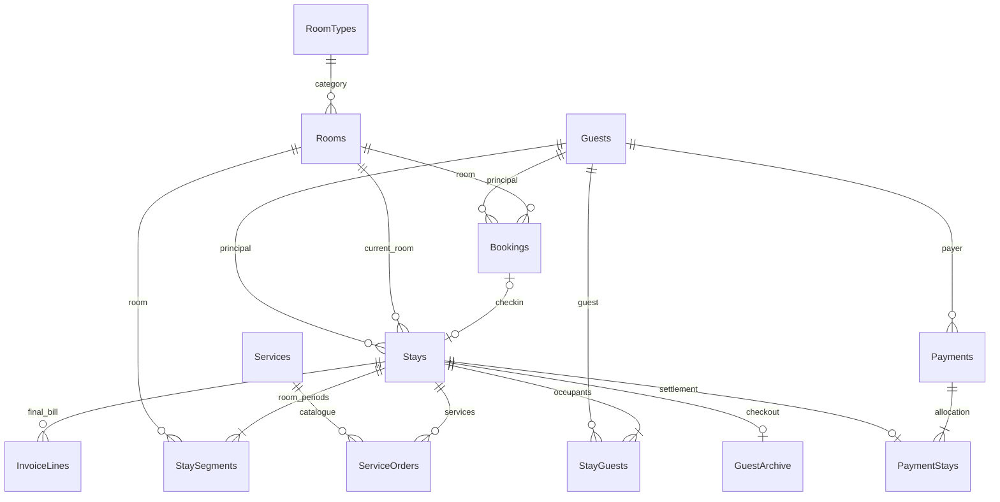

# Реализованная модель данных версии 6

15 пользовательских таблиц, 116 столбцов, 19 внешних ключей; 66 триггеров. Денежные поля с суффиксом Kopecks — целые копейки. Старые REAL-поля сохраняются для совместимости и истории, новые расчёты их не используют. Даты ISO yyyy-MM-dd. Версия задаётся PRAGMA user_version.

AuditLog хранит события создания, изменения, отмены и закрытия. AppSettings содержит настройки оформления; изображения пользователя при изменении оформления не заменяются.

StaySegments сохраняет RoomNumber, DateFrom, DateTo и RateKopecks. Открытый период один на проживание. Stays.RoomId — текущий/последний номер. StayGuests включает основного гостя и дополнительных проживающих. InvoiceLines хранит описание, количество, тариф и итог закрытого счёта. Payments сохраняет имя плательщика на момент расчёта. GuestArchive сохраняет имя гостя и последнюю комнату при выезде.

Rooms.Status служит совместимости с исходной схемой и отражает только ремонт/доступность эксплуатации. Пользовательская занятость рассчитывается по Bookings и активным Stays. Индексы обеспечивают уникальный нормализованный паспорт, одно активное проживание комнаты, один открытый тарифный период и один итоговый платёж на проживание.

## Питание и версия 6

ServiceOrders.OrderDate хранит выбранный день питания; для обычных услуг — текущую дату. Для нового питания действует сегодня ≤ дата < плановый выезд. На сегодня заказы принимаются строго до 10:00 / 14:00 / 20:00 (завтрак / обед / ужин). Повторение проверяется по гостю, виду и дню. Версия 6 заменяет правила без изменения состава столбцов и сохранённых заказов.
